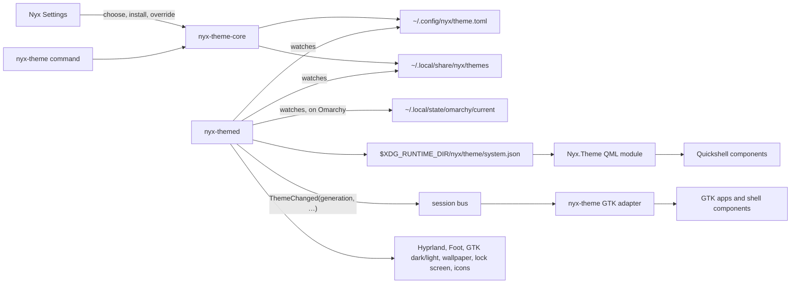

# Theme Engine 2.0: architecture

One theme engine for the whole desktop. A theme is defined once, resolved by one
library, and reaches GTK apps, Quickshell components, the shell and the rest of the
desktop through adapters that never resolve themes themselves.

## Pieces

| Piece | Where | What it does |
|---|---|---|
| `nyx-theme-core` | `nyx-design/crates/nyx-theme-core` | The engine, without GTK: schema, registry, resolver, choices, installer, Omarchy import, contrast checks, snapshot, D-Bus contract |
| `nyx-theme` (GTK adapter) | `nyx-design/crates/nyx-theme` | The resolved theme as one live stylesheet per app; the public API every Nyx app already uses |
| `Nyx.Theme` (QML adapter) | `nyx-design/qml/Nyx/Theme` | `NyxTheme` singleton with reactive tokens, `ThemeTransition` |
| `nyx-theme` command | `nyx-design/crates/nyx-theme-cli` | Everything from a shell; Omarchy's hook; the QML module's first snapshot |
| `nyx-themed` | `nyx-system/apps/themed` | `io.github.design_nexus.nyx.Theme1`, the snapshot, generations, and the non-Nyx outputs |
| Nyx Settings | `nyx-settings/…/sections/themes.rs`, `theme.rs`, `nyx.rs` | System theme, library, GitHub install, Omarchy import, app themes, reset |

## Sources of truth

- **Choices** live in one file, `~/.config/nyx/theme.toml`: the system theme
  (`mode`, `theme`), each app's choice (`[applications."nyx-files"]`), and the
  user's own token values (`[tokens]`). Apps no longer keep a copy.
- **Themes** are built in (compiled into the library), installed with the system
  (`$XDG_DATA_DIRS/nyx/themes`), installed by the user (`~/.local/share/nyx/themes`,
  with `registry.toml` recording where each came from), or the user's own files
  (`~/.config/nyx/themes`).
- **Resolution** happens in `nyx-theme-core` only. Every client that links it
  resolves the same files the same way, so clients agree even without the service.

## Following the system

- On **NyxOS** the system theme is the one chosen in Settings; the default is
  Catppuccin Mocha.
- On **Omarchy** the system theme follows the active Omarchy theme
  (`mode = "omarchy"`, the default there), read live from its `colors.toml` through
  the same translation the importer uses. Choosing a Nyx theme instead sets
  `mode = "theme"`. Without an Omarchy theme the engine falls back to Catppuccin Mocha.
- **Standalone apps** follow the system theme unless they have an override.
- **Shell components** (bar, dock, panels, switcher, widgets, the prompt) always
  follow the system theme (`nyx_theme::use_shell_scope()`); their plugins get the
  host's theme. The **login screen** and **lock screen** show their own set theme
  (`nyx_theme::use_fixed_theme`).

## Live changes

1. A change is written to a choices file or theme folder (by Settings, the command,
   or by hand).
2. Whoever made it publishes the next **generation**: the resolved system theme as an
   immutable snapshot, written to a temporary file and renamed into place under a lock,
   then `ThemeChanged` on the session bus. `nyx-themed`, when running, notices file
   changes made by anyone else and does the same.
3. GTK apps hear `ThemeChanged` (or, without a bus, see the file change through GIO
   file monitors), re-resolve, and reload their sheet once; an identical sheet isn't
   reloaded. A generation older than the one applied is ignored.
4. QML components see the snapshot file replaced and move to it whole.

A client that reconnects (service restart, suspended app) reads the current
generation instead of relying on missed events. Nothing polls.

## Failure handling

- A theme with errors can't be selected (`set_system_theme`, `set_app_override`) or
  installed; the current theme stays.
- An update that fails any check leaves the installed version; the version before
  each update is kept for `nyx-theme rollback`.
- A theme file that breaks later (hand-edited) still resolves: each bad value is
  reported and replaced by its default, the same way in every client, so the desktop
  stays consistent and complete.
- A missing override theme makes that app follow the system until the theme is back;
  the choice is kept.

## Security

Themes are data. The installer clones with git's local and helper transports off,
copies only data files (TOML, images, text), refuses links and oversized themes,
leaves out executables and scripts (and reports them), rejects manifests with hook
keys, validates and resolves the theme in a staging folder, and moves it into place
atomically. Nothing from a theme is ever executed. Omarchy themes keep their
scripts and app configuration out; only the palette, wallpapers and preview are used.
